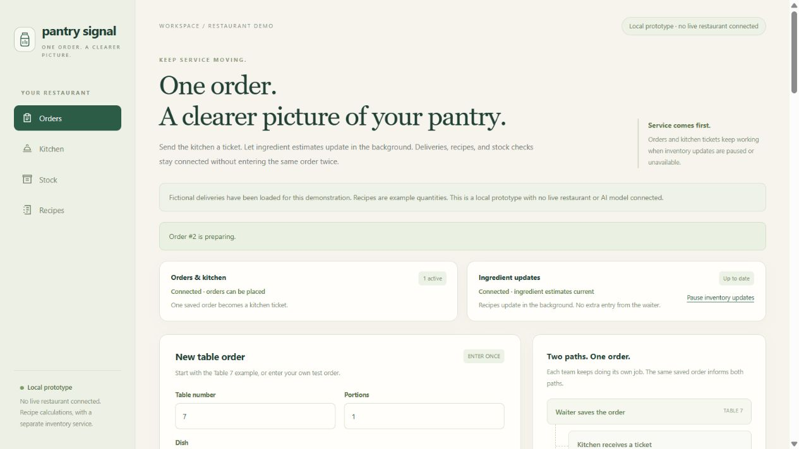

# Pantry Signal

A local restaurant prototype: enter an order once, send it to the kitchen,
and calculate ingredient reservations and usage in a separate service.

**This is a demonstration, with fictional recipes and optional fictional deliveries.**
It has no connection to a real restaurant, payment terminal, or live AI model.
Recipe arithmetic drives the estimates. Real recipe quantities need approval
by the restaurant before any operational use.

## Website and interactive sample

[Visit the Pantry Signal website](https://fortikday.github.io/pantry-signal/)
to see the actual app, watch a 20-second recorded walkthrough, and try the
Table 7 example without installing anything. The interactive sample uses fictional
data in browser memory; it does not save restaurant records or connect to the
local services. Restaurant owners and kitchen managers can share their workflow
through the website's feedback invitation. For persistent local orders, deliveries, and stock checks,
download this project and follow the launch instructions below.

The website source lives in `docs/`. See [the contributor guide](CONTRIBUTING.md#product-website)
for preview and test commands.



## Open it

Use Python 3.11 or newer. No extra packages are needed to run the app.
On Windows, double-click **Start Pantry Signal.cmd**. Alternatively:

```sh
python app.py
```

The app opens at [127.0.0.1:8770](http://127.0.0.1:8770).
Keep its running window open. Press Ctrl+C in that window when finished.
The inventory service uses port 8771. Both services bind only to this computer.

## Try the Table 7 example

1. Choose **Load fictional deliveries** to add five labelled sample ingredient batches.
2. Place one **Caesar salad** order for **Table 7**, with **Chicken** and **Shrimp**.
3. Watch the kitchen ticket appear. Inventory reserves the recipe quantities
   after the background service catches up. Sample chicken quantity: **400 g**.
4. Start preparing the ticket. The reservation becomes recorded recipe usage.
   The sample 5,000 g of chicken becomes 4,600 g on hand, with no reservation left.
5. Mark it ready. Inventory is not deducted again.
6. Pause inventory sync and place another order. The kitchen continues working.
   Resume sync to process the saved events once, including any kitchen changes.

The initial menu has three fictional dishes and five ingredient types. Change
their quantities in **Recipes**. Existing orders retain the recipe snapshot
from when they were placed; later recipe changes affect later orders.

## Stock and dates

- **On hand:** received grams minus recorded recipe usage and logged waste.
  This is an estimate and can become negative when records are incomplete.
- **Reserved:** ingredients required by queued orders not yet prepared or cancelled.
- **Available:** a conservative estimate using dated batches, on-hand balance,
  and reservations. Batches past their recorded date or without a date are excluded.
- **Unallocated usage:** cooking requirements that could not be assigned to an
  eligible recorded batch. Investigate these gaps before trusting the balance.

Batch allocation assumes earliest recorded expiry first among batches received
by the recorded preparation date. It does not prove which batch the kitchen used.
Expiry displays are reminders based on entered dates, not a determination of
freshness or food safety. The prototype does not manage opening dates, storage
temperatures, preparation yields, or prepared subrecipes such as sauce batches.

Record a measured stock count to compare it with the estimate at that moment.
The count saves an unexplained difference; it does not change the stock ledger
or identify a cause such as waste or theft. Check that inventory sync has caught
up before comparing counts.

The stock area shows the last successful inventory sync time. Paused, unavailable,
delayed, or inconsistent updates mark the quantities as a **last estimate**, with
muted numbers and a warning beside them. A successful HTTP response alone does
not establish that the background worker is still updating. An old sync time
also blocks comparing a physical count until updates recover.

Cancelling a queued order releases its reservation. Cancelling a dish after
preparation leaves its usage recorded. A cancellation does not establish that
food was discarded, so record any actual waste separately with care to avoid
counting ingredients already deducted for that dish twice.

## Independent services

The order service commits each kitchen change and its event together in
`local/orders.sqlite3`. The inventory service reads those events over HTTP and
updates `local/inventory.sqlite3`. Each event is applied once in the same
transaction as its saved cursor. Replaying an event cannot deduct stock again.
An order request ID also protects against duplicate order submission.

The inventory service pins the identity of its source order log. A replaced or
rewound source log requires investigation rather than silent replay against a
different history. Preserve both database files as one pair.

To run the services independently for development:

```sh
python app.py --orders-only --no-browser
python app.py --inventory-only --source-url http://127.0.0.1:8770
```

You may choose `--data-dir`, `--orders-port`, and `--inventory-port` for isolated
demonstrations. A paused or unavailable inventory service does not block order
creation or kitchen transitions. It catches up when available again.

## Keep records private

The prototype has no accounts, permissions, multi-restaurant isolation, or hosted
deployment. Keep it local. Do not expose its ports to the internet or use it as a
production ordering system. To copy a local demonstration log, stop **both**
services first and copy the complete data folder; keep both databases together.
Never publish that folder or real supplier, staff, or customer information.

## Checks and next step

The runtime has no external packages. Development dependencies are pinned in
`requirements-dev.txt`. Run the Python checks with:

```sh
python -m pip install -r requirements-dev.txt
python -m pytest tests -q
```

Front-end behavior checks use Node.js 24, with no npm packages:

```sh
node --test tests/frontend/*.test.cjs
```

The JavaScript checks execute the page's actual script in a simulated DOM with
controlled network responses and timers. They do not test browser layout.
The current version passed **147 automated checks**: 89 domain, 18 HTTP, and
40 front-end behavior tests on 22 October 2026.
See [the contributor guide](CONTRIBUTING.md) for isolated setup, coverage limits,
and a repeatable manual walkthrough. [Verification results](results/verification.json)
record the automated checks and manual browser observations separately.

The next validation step is a small restaurant trial using approved recipes and
measured counts, before connecting a real ordering system or adding forecasting.
There is no claim of measured waste savings or proven business demand.

Accounts and restaurant permissions are required before a hosted version.
An audited correction for mistakenly ready tickets, preparation yields, and
prepared subrecipes are further workflow features to design with a kitchen;
they are not implemented here.

Code is available under the [MIT licence](LICENSE).
